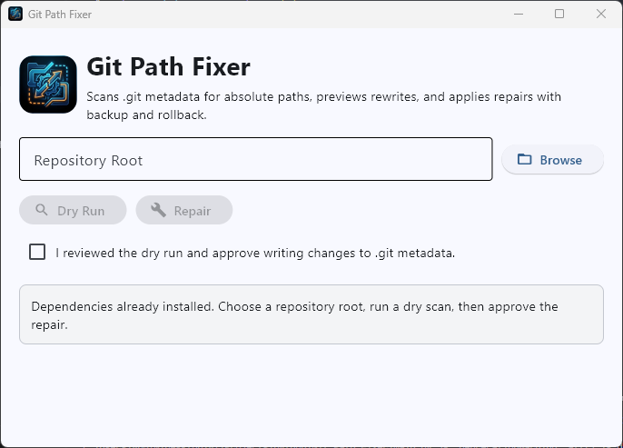
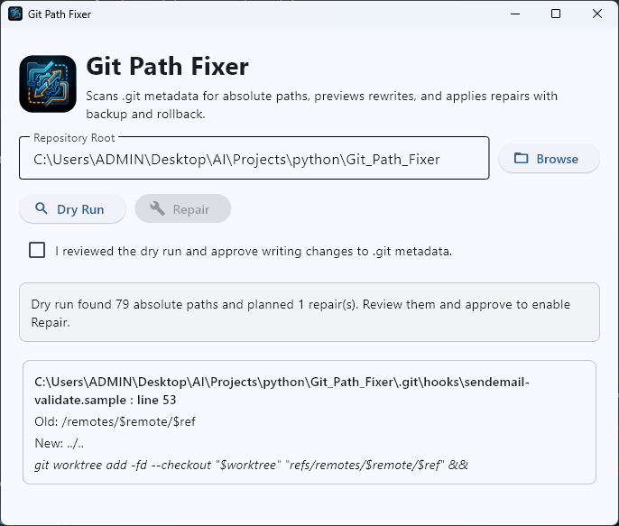
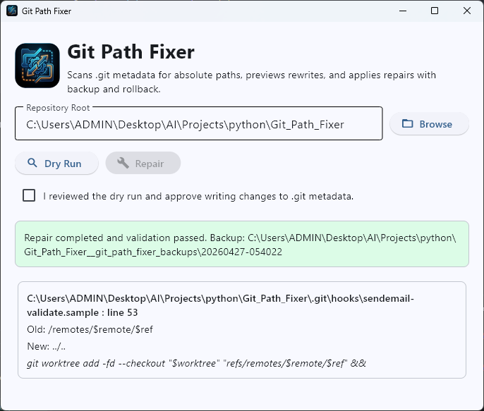

# Git Path Fixer

<p align="center">
  
</p>

<p align="center">
  Repair broken absolute paths inside <code>.git</code> metadata after a repository is moved, restored, or copied to another machine.
</p>

Git Path Fixer is a small desktop app for developers who end up with a repository that still works just enough to be confusing, while parts of `.git` quietly point at an old folder, drive, or machine. That usually surfaces through broken worktrees, hooks, or submodule metadata — the kind of thing people often fix by hand, line by line.

This app gives you a safer, more legible workflow: scan first, inspect the exact rewrite plan, approve, and keep a backup in case anything needs to be rolled back.

---

## Quick Start

```bash
pip install -r requirements.txt
python main.py
```

---

## Workflow

### 1. Open the Repository

Browse to the repository root you want to inspect. The app stays read-only at this point.



### 2. Fix Git Ownership (if migrated from another machine)

If you moved repos from another machine or user account, git may refuse to operate on them due to an ownership mismatch:

```
fatal: detected dubious ownership in repository at '...'
```

Click **Fix Git Ownership** to resolve this. The app runs:

```bash
git config --global --add safe.directory <your-repo-path>
```

This trusts only the specific repo you selected — it does not use the wildcard `*` and does not disable git's ownership checks globally.

If you have many migrated repos and prefer to handle them all at once from a terminal, you can run this PowerShell snippet instead:

```powershell
Get-ChildItem -Path C:\Users\HSEF\Desktop -Recurse -Filter ".git" -Directory | ForEach-Object {
    $repoPath = $_.Parent.FullName -replace '\\', '/'
    git config --global --add safe.directory $repoPath
    Write-Host "Added: $repoPath"
}
```

### 3. Run a Dry Scan

Click **Dry Run** to search `.git/config`, `.git/hooks`, and `.git/modules` for absolute Windows, UNC, and POSIX-style paths. No files are written at this stage.

### 4. Review the Repair Plan

The app shows the exact `.git` file, line number, old path, and replacement path for every repair it can safely make. Review everything before committing to any changes.



### 5. Approve and Repair

Check the approval box, then click **Repair**. The app:

1. Creates a full `.git` backup
2. Applies the rewrites
3. Validates the repository with `git rev-parse` and `git config --list`
4. Reports the backup location

If validation fails for any reason, the original `.git` is restored automatically from the backup.



---

## Notes

- The app only rewrites paths it can confidently map back to the selected repository root. It stays conservative on purpose.
- Backups are written to a sibling folder next to the repo: `<repo-name>__git_path_fixer_backups/<timestamp>/`
- Built with `flet>=0.28,<1.0`
